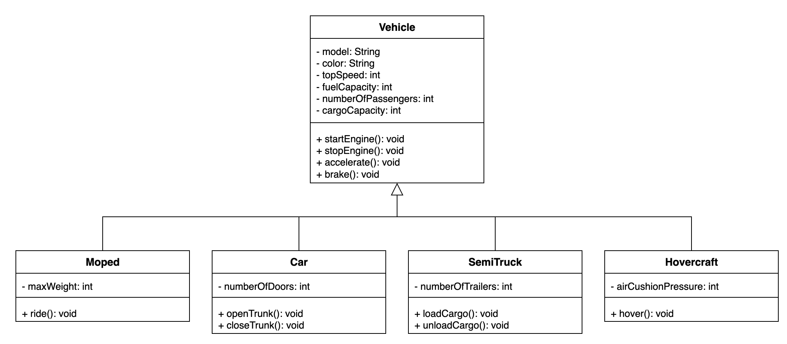
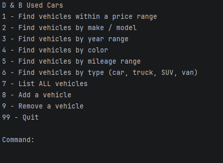
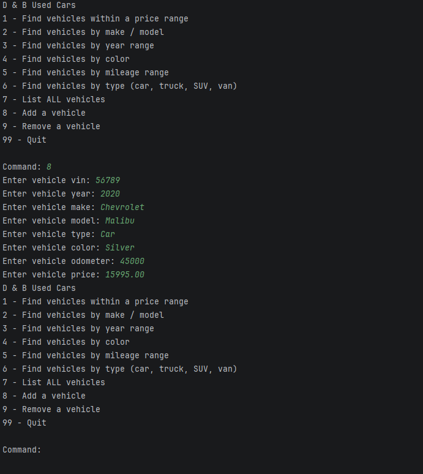
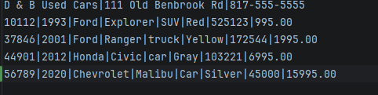
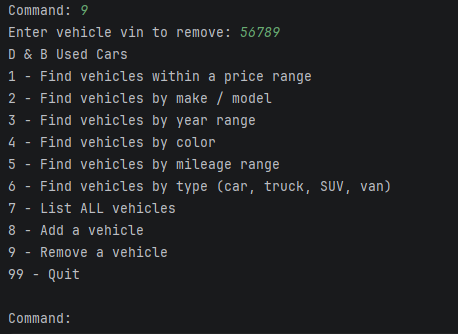
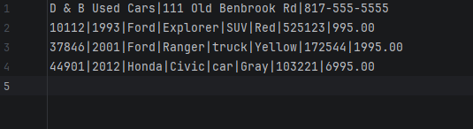

# Car-Dealership

- Car dealership is an application that manage and search its vehicle inventory.

## Description of the Project

- This project is a Java application that allows users to search, add, and remove vehicles from a dealership's inventory. 
  Users can search for vehicles by price, make, model, year, color, mileage, and vehicle type.
  The application uses a CSV file to store vehicle information and saves any changes made.


## Class Diagram



## Features

- Search vehicle by price range, make/model, year range, color, mileage range, and vehicle type.
- list all vehicles.
- add and remove vehicle.

## User Stories

- As a user, I want to search for vehicles by price, make/model, year range, color, mileage range, vehicle type, 
  so that I can find cars within range.
- As a user, I want to add new vehicles to the inventory, so that I can keep track of my cars.
- As a user, I want to remove vehicles from the inventory, so that I can remove any cars I want.

## Setup

### Prerequisites

- Java 17 (Amazon Corretto), the version used in class.
- IntelliJ IDEA Community Edition: <https://www.jetbrains.com/idea/download/>

### Running the application

1. Clone this repository, or download it as a zip and unzip it.
2. In IntelliJ: File > Open, pick the project folder (the one that holds `pom.xml`), press Open.
3. Wait for IntelliJ to finish indexing (progress bar at the bottom).
4. Open `src/main/java/com/pluralsight/YourMainClassName.java`. <!-- replace YourMainClassName with the class that has main -->
5. Right-click inside the file and choose Run 'YourMainClassName.main()'.

## Technologies Used

- Java 17
- IntelliJ IDEA

## Demo









## A piece of code I am proud of

- I'm proud of this code because it took the longest to figure out for me, but with failing and trying I figured it out!

- This code uses a method called getVehiclesByPrice() that takes a minimum and maximum price as parameters. 
  I created a new ArrayList called filterVehicle and used a for loop to go through the dealership's inventory. 
  The loop compares each vehicle's price with the minimum and maximum prices and adds the vehicle to the filtered list if its price is within the range.

```
    public ArrayList<Vehicle> getVehiclesByPrice(BigDecimal minPrice, BigDecimal maxPrice) {
        ArrayList<Vehicle> filterVehicle = new ArrayList<>();

        for (Vehicle vehicle : inventory) {

            BigDecimal price = vehicle.getPrice();

            if (price.compareTo(minPrice) >= 0 && price.compareTo(maxPrice) <= 0) {
                filterVehicle.add(vehicle);
            }

        }
        return filterVehicle;
    }
```

## Future Work

- Add more while loops to catch any mistakes the user makes

## Resources

- Java YearUp Fall 2026 hub: <https://raymaroun.github.io/yearup-java-fall2026/>
- https://raymaroun.github.io/yearup-java-fall2026/week-05/exercises/car-dealership.html
- https://www.geeksforgeeks.org/java/finding-minimum-and-maximum-element-of-a-collection-in-java/

## Author

- **Maalik McCutchen**

## Thanks

- Thank you to Raymond for providing us so many resources to complete our projects.